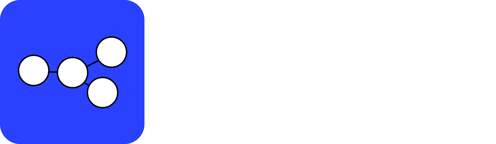
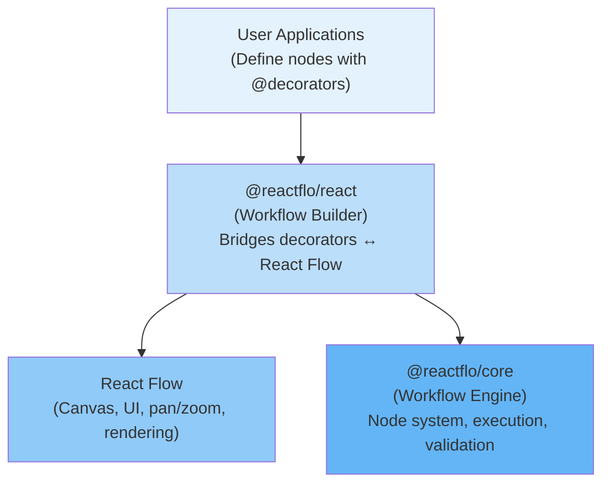

<div align="center">
  
</div>

<br/>

<p align="center">
  <a href="https://github.com/reactflo/reactflo/actions/workflows/ci.yml?branch=main"></a>
  <a href="https://github.com/reactflo/reactflo/releases"></a>
  <a href="LICENSE"></a>
</p>

# ReactFlo

**A declarative framework for building visual workflow editors.**

ReactFlo gives you everything needed to build custom workflow applications—AI agent platforms, automation tools, data pipelines, or no-code builders. Define nodes with TypeScript decorators, get a production-ready visual editor with execution engine included.

**We build the how, you focus on the what.**

Built on React Flow. Inspired by Node-RED, LangFlow, and modern automation platforms.

## Vision

The AI automation space is exploding. Every team needs workflow builders:

- AI developers building agent orchestration platforms
- No-code entrepreneurs creating automation tools
- Data teams building ETL and pipeline tools
- Enterprises automating business processes

But building a workflow editor is hard. Visual canvas, execution engine, JSON serialization, type-safe connections, validation, debugging—it's a lot.

**ReactFlo gives you all of this.** Stop reinventing the wheel.

ReactFlo is a framework, not a finished product. It provides the infrastructure so you can focus on your unique features and domain-specific nodes.

## Quick Start

**Define nodes with decorators:**

```typescript
import { Node, Input, Output, defineNode } from '@reactflo/core';

@defineNode({
  type: 'math.add',
  label: 'Add Numbers',
  category: 'Math',
})
class AddNode extends Node {
  @Input({ type: 'number', label: 'A' }) a: number;
  @Input({ type: 'number', label: 'B' }) b: number;
  @Output({ type: 'number', label: 'Result' }) result: number;

  execute() {
    this.result = this.a + this.b;
  }
}
```

**Get a visual builder:**

```tsx
import { WorkflowBuilder } from '@reactflo/react';

<WorkflowBuilder
  nodes={[AddNode]}
  onWorkflowChange={(workflow) => console.log(workflow)}
/>
```

Full guide: [Getting Started](docs/guides/get-started.md)

## Getting Started

```bash
npm install

npm run build

npm run dev
```

The dev command starts watch mode for all packages plus the examples dev server with hot-reload.

More details: [Development Workflow](docs/development/development-workflow.md)

## Documentation

- [Framework Documentation](docs/guides/get-started.md) - Complete guide to using ReactFlo
- [Developer Documentation](docs/development/development-workflow.md) - Development workflow and best practices
- [Roadmap & Status](docs/development/project-status.md) - Current progress and future plans
- [Documentation Index](docs/documentation-index.md) - Full documentation directory

## What You Can Build

ReactFlo is perfect for:

- AI agent orchestration platforms (LangFlow/Flowise alternatives)
- No-code automation tools (Zapier, Make.com, n8n alternatives)
- Data pipelines and ETL tools
- Business process automation
- CI/CD workflow builders
- IoT and smart home automation
- Visual programming environments

## Packages

ReactFlo is organized as a monorepo:

- `@reactflo/core` - Core workflow engine and node system
- `@reactflo/types` - TypeScript type definitions
- `@reactflo/react` - React components bridging decorators to React Flow
- `@reactflo/examples` - Example applications
- `@reactflo/landing` - Marketing/landing page
- `@reactflo/docs-site` - Official documentation site
- `@reactflo/cli` - CLI tools (planned)
- `@reactflo/plugins` - Official plugins (planned)

**Built on:** React Flow, TypeScript with decorators

## Architecture

ReactFlo adds a declarative layer and execution engine on top of React Flow:



We leverage React Flow for the UI layer and focus ReactFlo on declarative node definitions, automatic registration, and powerful execution.

## Contributing

We welcome contributions! See [CONTRIBUTING.md](CONTRIBUTING.md) for guidelines.

## License

MIT License - see [LICENSE](LICENSE) for details.

---

**We build the how, you focus on the what.**

